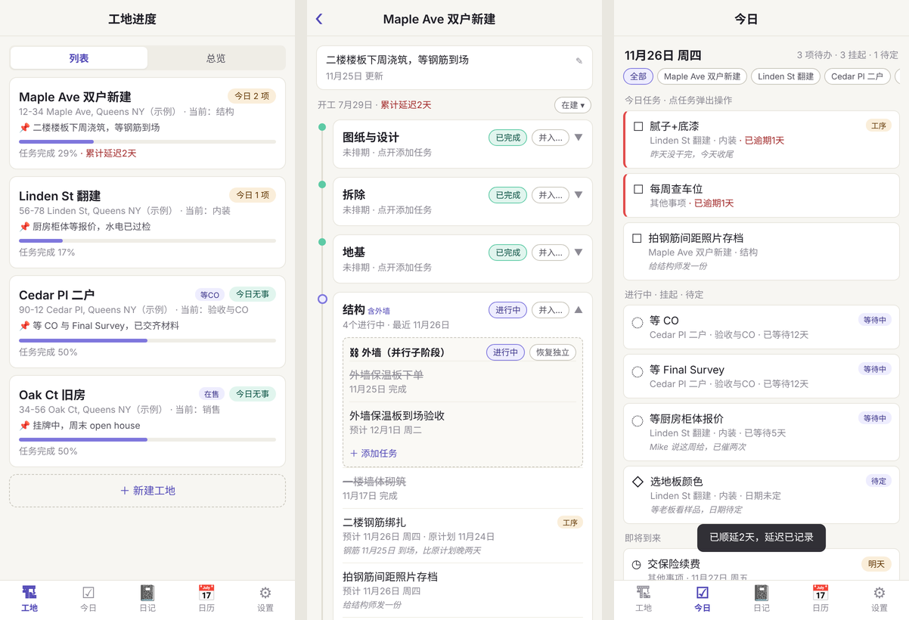
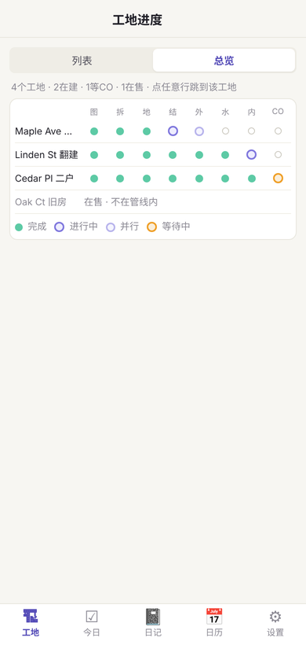
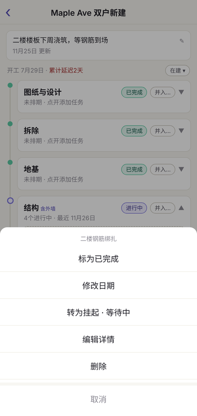
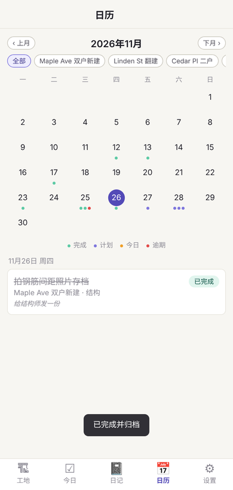
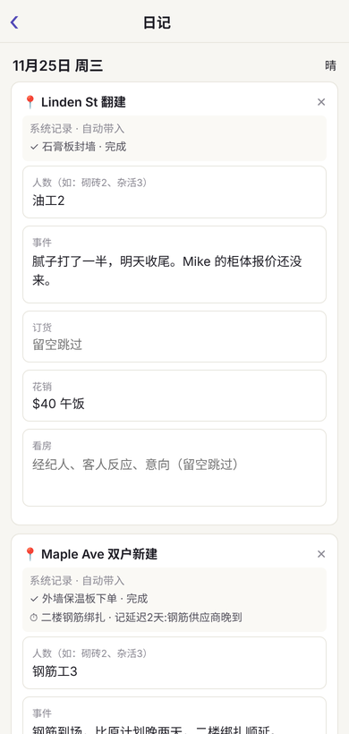

# 工地进度 · Site Tracker

**Progress tracking for a small construction / rebuild crew — built as a WeChat mini program, ported here to a plain web app so anyone can try it.**

**[▶ Live demo](https://charleschaohu-hash.github.io/gongdi-web/)** — works on a phone or in a desktop browser (phone frame). Sample data is fictional and generated relative to today; your edits stay in your own browser.

<p align="center"></p>

[中文说明在下方](#中文说明)

## Why it exists

A small developer (buy old house → demolish → rebuild → sell) ran a dozen sites out of WeChat group chats, memory and paper. Generic project-management tools didn't fit: on a job site, dates are discovered rather than planned, and one delay pushes everything behind it. The tool was designed from those pains and used daily by the owner and assistant manager.

## What's different about it

| Rule | What it does |
|---|---|
| **Process tasks cascade** | Mark a task as a *process step* (工序). Push its date back and every later process step in the same stage moves by the same number of days; a delay record with the reason is written automatically. Moving a date earlier is just "ahead of schedule" — no record. |
| **Two-track dates** | Every task keeps `planDate` (original, never overwritten), `currDate` (current plan) and `doneDate` (actual). The timeline shows "expected Nov 26 · originally Nov 24" so slippage is visible, not hidden. |
| **"To be decided" is honest** | A task can have no date. It stays on the timeline but off the today list and calendar — no fake dates to make the schedule look complete. |
| **Waiting tasks show their age** | "Waiting for CO · 12 days" — made for the things you sent out and are waiting on. |
| **Stages advance themselves** | When every task in a stage with process steps is done, the stage closes and the next one opens. Stages can be merged as parallel sub-stages (e.g. façade running under structure). |
| **Status note > progress %** | Each site has a one-line "where we are" note with its date; the owner reads that, not a percentage. |
| **Diary pulls in the system** | A day's diary auto-lists that day's completions and delays per site; you add headcount, events, orders, spend, showings. "Tomorrow" items convert to tasks with one tap. |

## Pages

Sites (list + pipeline matrix) · Timeline per site · Today (due / overdue / waiting / upcoming / archive, filter by site) · Calendar · Diary · Settings (stage template, quick next-step buttons).

<p align="center">   </p>

## How this repo is laid out

```
index.html          app shell: nav bar, view, tab bar, toast
css/app.css         styles ported from the mini program's app.wxss (rpx → px)
js/store.js         data layer — ported from miniprogram/utils/store.js; all business rules live here
js/app.js           the 9 pages as a hash router + string templates
js/ui.js            action sheet / modal / toast (replacements for wx.showActionSheet etc.)
js/demo.js          fictional sample data, dated relative to today
miniprogram-src/    the original WeChat mini program (WXML/WXSS/JS + cloud function), for comparison
docs/screenshots/
```

No build step, no framework, no dependencies. Open `index.html` or serve the folder.

**What the web port leaves out** (all of it depends on the WeChat platform): multi-user cloud sync, whitelist + invite-code access control, admin/member roles and task assignment, WeChat subscription-message reminders. The original implementation of those is in `miniprogram-src/`.

## How it was built

Designed and coded with [Claude](https://claude.com) over about two weeks: seven rounds of clickable prototypes to settle the interaction rules, then the mini program (local-storage v1–v3, cloud v4.x), then this web port. The data-layer boundary (`store.js` as the only place that reads or writes data) was a deliberate early decision so the storage backend could change without touching pages — it's what made this port a few hours of work instead of a rewrite.

## License

MIT

---

## 中文说明

小型建筑 / 翻建团队的工地进度管理工具。原生微信小程序，这里是网页移植版，任何人打开链接就能试：**https://charleschaohu-hash.github.io/gongdi-web/**

**它解决什么**：一家"买旧房 → 拆 → 重建 → 卖"的小开发商，十来个工地靠微信群、脑子和纸在管。通用项目管理软件不合适——工地上的日期是"到了才知道"，而且一道工序延误会把后面全部拖住。这套工具就是从这些真实痛点里长出来的，老板和助理经理每天在用。

**核心规则**：工序任务改期自动记延迟并顺延同阶段后续工序；原计划 / 当前计划 / 实际完成三条日期并存，拖了多久一眼看见；日期可空＝待定，不造假账；挂起任务显示"已等待 N 天"；阶段内任务全完成自动推进下一阶段，阶段可并入成并行子阶段；每个工地一句现状便签比进度百分比有用；日记自动带入当天的完成与延迟记录，"明日事项"一键转任务。

**网页版没有的**（都依赖微信生态）：多人云端同步、白名单＋邀请码门禁、管理员/员工分级与任务指派、微信订阅消息提醒。原实现见 `miniprogram-src/`。

**怎么做的**：用 Claude 从交互原型 v1–v7 一路做到小程序云开发版，再移植到网页。一开始就把所有数据读写收口在 `store.js` 一个文件里，所以这次换存储后端只重写了这一个文件，页面逻辑原样搬。
